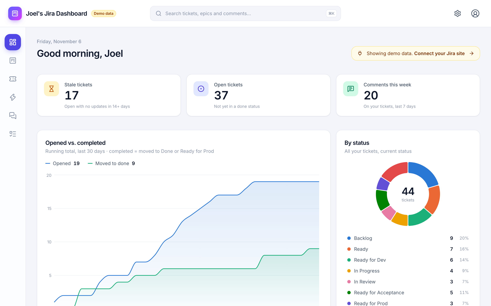
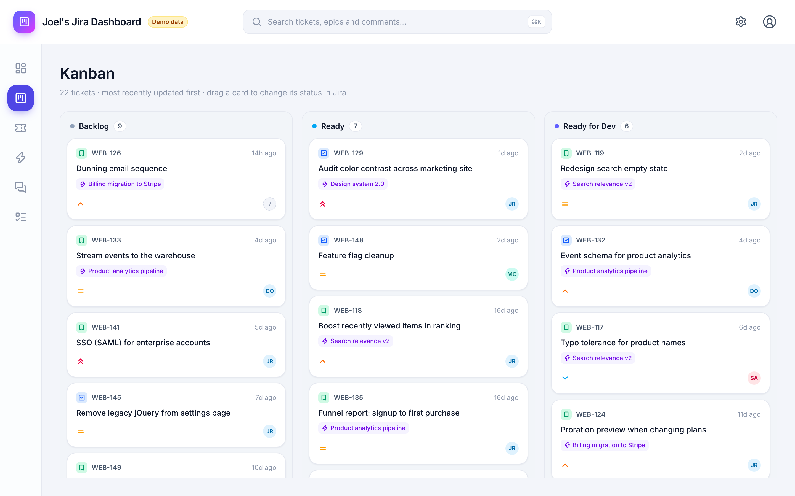
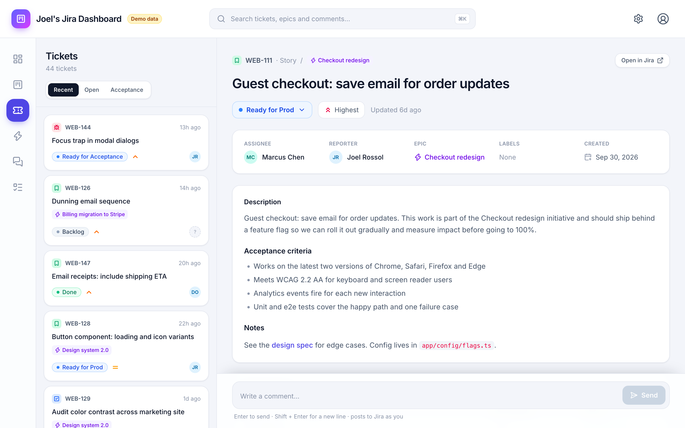
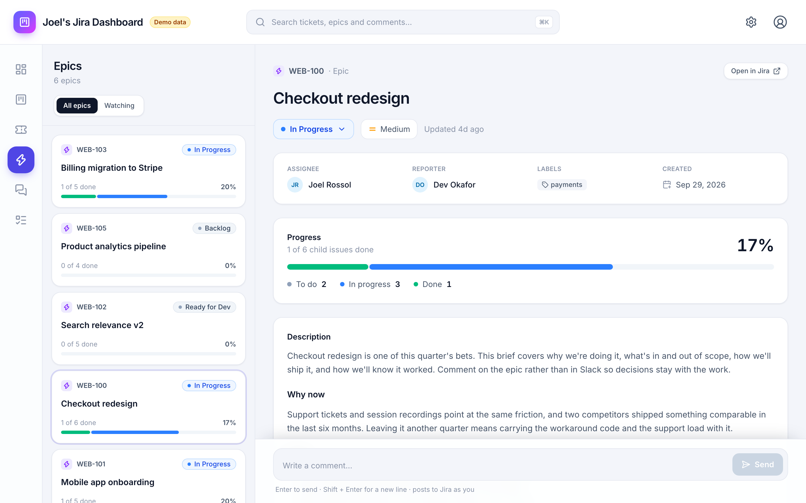
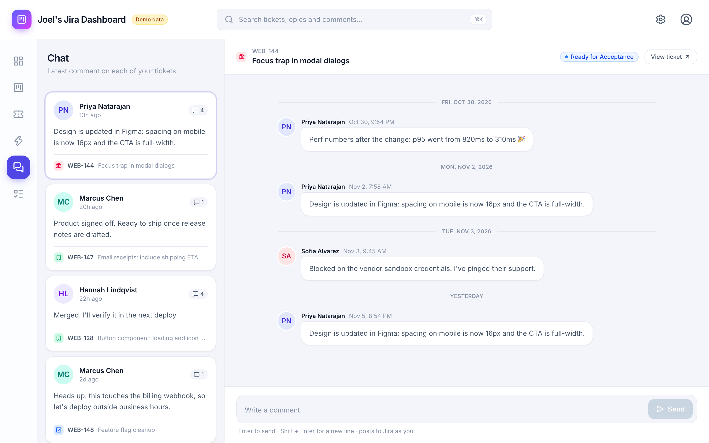

# Jira For Product Dashboard

A clean, self-hosted dashboard for **your own** Jira Cloud work. See what's stale, what's open and who's waiting on you, all on one page. Move tickets on a drag-and-drop Kanban board, and reply to comments without digging through Jira.

It runs on your own computer (or on Vercel) and talks to Jira through its official REST API. Your API token never leaves the server.

**Try it in two minutes, with no Jira account needed.** Out of the box it runs on built-in demo data.



## Features

- **Dashboard.** Stale tickets, open tickets and this week's comments at a glance, plus:
  - an opened vs. completed chart for the last 30 days
  - a status breakdown
  - the epics you watch
  - recent comments
  - a Kanban preview
  - tickets waiting for your acceptance
- **Kanban board.** Drag a card to another column and its status changes in Jira.
- **Tickets and epics.**
  - A list of your tickets or epics, with full detail for whichever one you select.
  - A status dropdown that runs your real Jira workflow.
  - Long descriptions collapse.
  - A table of related tickets: the epic, subtasks, children and links.
  - The full conversation, with a comment box pinned to the bottom.
- **Chat.** Every ticket with recent comments in one inbox. Replies post straight back to Jira.
- **Demo mode.** Explore with sample data, and switch back and forth any time from **Settings**. Nothing you do in demo mode touches Jira.

| Kanban | Ticket detail |
| --- | --- |
|  |  |
| **Epic detail** | **Chat** |
|  |  |

## Quick start

You need **[Node.js](https://nodejs.org/) 20.9 or newer** (check with `node -v`) and **git**.

```bash
git clone https://github.com/joelrossol/jira-for-product.git
cd jira-for-product
npm install
npm run dev
```

Open **http://localhost:3000**. You'll see the dashboard filled with demo data.

## Connect your Jira Cloud site

This works with **Jira Cloud** (`*.atlassian.net`), including the free plan. Jira Server and Data Center aren't supported.

1. **Create an API token** at [id.atlassian.com → Security → API tokens](https://id.atlassian.com/manage-profile/security/api-tokens). Choose **Create API token**, not the "with scopes" option, then copy the token.

2. **Create your local settings file** from the template:

   ```bash
   cp .env.example .env.local
   ```

   On Windows, use `copy .env.example .env.local`.

3. **Fill in the three values** in `.env.local`:

   ```bash
   JIRA_BASE_URL=https://your-team.atlassian.net
   JIRA_EMAIL=you@example.com
   JIRA_API_TOKEN=paste-your-token-here
   ```

   Use just the site address for `JIRA_BASE_URL`, not a link to a ticket or board.

4. **Restart** the app (press `Ctrl+C`, then run `npm run dev` again).

When it's connected, the "Demo data" badge disappears and **Settings** shows your name and a green "Connected" badge.

> `.env.local` is listed in `.gitignore`, so your token is never committed. Never put a real token in `.env.example`, because that file *is* committed.

## Match it to your workflow

Every team's Jira workflow is different. The dashboard looks for status names, so if a Kanban column or the "Ready for acceptance" section stays empty, your statuses probably have different names. Add any of these to `.env.local` and restart:

| Setting | Default | What it controls |
| --- | --- | --- |
| `JIRA_KANBAN_COLUMNS` | `Backlog,Ready,Ready for Dev` | Status names shown as Kanban columns, left to right |
| `JIRA_DONE_STATUSES` | `Done,Ready for Prod` | Statuses that count as "completed" in the chart |
| `JIRA_ACCEPTANCE_STATUSES` | `Ready for Acceptance` | Statuses shown in the "Ready for acceptance" tiles |
| `JIRA_SCOPE_JQL` | `assignee = currentUser() OR reporter = currentUser()` | Which tickets count as "yours" (JQL, without `ORDER BY`) |
| `JIRA_PROJECTS` | (all projects) | Comma-separated project keys to limit everything to |
| `JIRA_STALE_DAYS` | `14` | Open tickets with no update for this many days count as stale |
| `JIRA_MAX_ISSUES` | `1000` | Cap on issues fetched for dashboard stats |
| `JIRA_DEMO` | (off) | Set to `1` to force demo data for everyone. Without it, each browser can switch with **Settings → Use demo data**. |

For example, for a workflow of *To Do → In Progress → In QA → Done*:

```bash
JIRA_KANBAN_COLUMNS=To Do,In Progress,In QA
JIRA_DONE_STATUSES=Done
JIRA_ACCEPTANCE_STATUSES=In QA
```

Status names are matched case-insensitively. **Settings** (the gear icon) shows the values in effect.

## Run the production build

`npm run dev` is best while you're trying things out, because it picks up changes as you go. For a faster, production-style server:

```bash
npm run build
npm start
```

`npm start` serves the last build, so run `npm run build` again after pulling new code or changing settings that affect the build.

## Deploy to Vercel (optional)

1. Fork or push this repo to your GitHub account and import it at [vercel.com/new](https://vercel.com/new). The defaults work as-is.
2. Under **Project Settings → Environment Variables**, add `JIRA_BASE_URL`, `JIRA_EMAIL`, `JIRA_API_TOKEN`, plus any optional settings.
3. Deploy.

> **Important:** the app has no login of its own. Anyone who can reach the URL can see your Jira data and comment or change statuses *as you*. Turn on Vercel's **Deployment Protection**, or put the app behind your own authentication, before adding credentials.

## Security and privacy

- **Credentials stay on the server.** The browser only talks to this app's own `/api` routes. Those routes call Jira with your token, so the token is never sent to the browser.
- **Secrets live only in `.env.local`** (git-ignored) or your host's environment variables. The committed `.env.example` contains no real values.
- **The app acts as you.** Comments, status changes and Kanban moves are made with your Jira account and show up under your name.
- **If a token leaks,** revoke it on the same [API tokens page](https://id.atlassian.com/manage-profile/security/api-tokens) and create a new one.

## Troubleshooting

| What you see | What to do |
| --- | --- |
| Still showing demo data after adding credentials | All three values must be set. Restart the app, check that **Settings → Use demo data** is off, and make sure `JIRA_DEMO` isn't set. |
| "Jira rejected the email or API token" | Check `JIRA_EMAIL` and `JIRA_API_TOKEN`: no quotes or extra spaces, and a token created with **Create API token**. |
| "…sent back a web page instead of Jira data" or "Unexpected token '<'" | `JIRA_BASE_URL` should be just your site, like `https://your-team.atlassian.net`. |
| "Couldn't reach https://…" | Check the spelling of `JIRA_BASE_URL` and your internet connection. |
| A Kanban column is always empty | Your workflow has no status with that name. Set `JIRA_KANBAN_COLUMNS` to your real status names. |
| A Kanban drop says "Jira's workflow doesn't allow…" | Your Jira workflow has no transition between those two statuses. Move the ticket in steps, or change the workflow in Jira. |
| Code changes don't show up with `npm start` | Run `npm run build` first, or use `npm run dev`. |
| Port 3000 is already in use | Run on another port: `npm run dev -- -p 3001`. |

## Tech stack

[Next.js 16](https://nextjs.org/) (App Router) · React 19 · TypeScript · [Tailwind CSS 4](https://tailwindcss.com/) · [Recharts](https://recharts.org/) · [SWR](https://swr.vercel.app/) · [Lucide](https://lucide.dev/) icons · Jira Cloud REST API v3

## Project layout

```
src/
  app/                 pages, plus the /api route handlers the browser calls
  components/          UI: cards, Kanban, detail views, conversation, charts, app shell
  lib/
    jira/              Jira Cloud REST client and response normalization
    demo/              the in-memory demo dataset
    services.ts        dashboard, Kanban, thread and epic logic shared by live and demo data
    provider.ts        picks live Jira or demo data for each request
    config.ts          reads settings from environment variables
```

| Script | What it does |
| --- | --- |
| `npm run dev` | Start the development server at http://localhost:3000 |
| `npm run build` | Build for production |
| `npm start` | Serve the production build |
| `npm run lint` | Lint with ESLint |
| `npm run typecheck` | Type-check with TypeScript |

## Roadmap

- A to-do list page
- Search across tickets, epics and comments from the header

## Contributing

Issues and pull requests are welcome. Before opening a PR, run `npm run lint` and `npm run typecheck`. While developing, set `JIRA_DEMO=1` (or use the **Settings** switch) so you don't change real tickets by accident.

## License

Released under the [GNU General Public License v3.0](LICENSE). © 2026 Joel Rossol

---

This is a personal project. It's not affiliated with, endorsed by or supported by Atlassian. Jira is a trademark of Atlassian.
